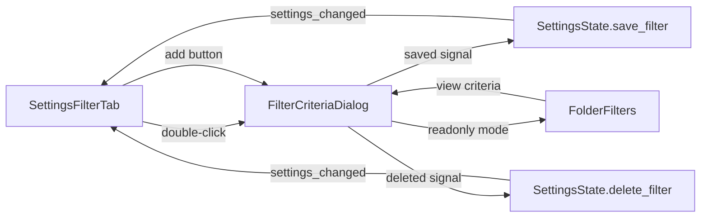

# Requirements

### Overview & Goals
Redesign the Settings → Filters tab to scale to hundreds of filters. Replace the current multi-row-per-filter layout (name + type combo + full `FolderFilterTable` per filter) with a compact single-row-per-filter list, and use a modal dialog for viewing/editing filter criteria.

### Scope
**In Scope:**
- Compact filter list in `SettingsFilterTab` showing filter name, criteria count, and criteria type badges (one row per filter, truncated with `...`)
- Search bar above the list: filter by name, criteria type dropdown, tag value picker
- Icon buttons (fa6s): add filter (`+`), delete filter (trash/`✕`)
- Double-click a filter row → opens `FilterCriteriaDialog` (modal) with criteria editing, filter name field, and save/cancel/delete buttons
- New `media_nav_search/` module housing the reusable `FilterCriteriaDialog`
- Extract filter criteria popup from `FolderFilters` into the new module

**Out of Scope:**
- Changes to filter criteria evaluation logic (`DbFilter`, `FolderFilterFilter`)
- Changes to how filters are applied to folder navigation
- Changes to the `FolderFilters` nav widget's saved filters combo or tag button behavior (beyond reusing the extracted dialog)

### Functional Requirements
1. **Filter list**: Show all saved filters in a `QTableWidget`, one row each, with columns for name (truncated), criteria count, and criteria types.
2. **Search & filter**: Text box filters by name; dropdown filters by criteria type; tag button opens tag picker to filter by tag values.
3. **Add filter**: Click `+` button → opens `FilterCriteriaDialog` in add mode with empty criteria. User enters name and criteria, clicks save.
4. **Edit filter**: Double-click a row → opens `FilterCriteriaDialog` in edit mode with existing criteria. User modifies, clicks save.
5. **Delete filter**: Click `✕` on a row, or delete button in dialog → removes the filter from the list and persists.
6. **Close dialog**: Click `✕` (close), cancel (discards changes), or save/delete (persists and closes).
7. **Persistence**: Save and delete operations call `SettingsState.save_filter()` and `SettingsState.delete_filter()` respectively.

# Technical Design

### Current Implementation
- `SettingsFilterTab` (`settings_filter_tab.py`): Creates a `FilterRowContainer` per filter, each containing a name `QLineEdit`, type `QComboBox`, and a full `FolderFilterTable`. This doesn't scale — each filter gets a large widget.
- `FolderFilters` (`folder_filter.py`): Has `_build_filter_criteria_popup` (lines 325–352) that creates a `QDialog` with `FolderFilterTable` (readonly) for viewing criteria in the nav area.
- `FolderFilterTable` (`folder_filter_table.py`): `QTableWidget`-based component for displaying/editing filter criteria. Supports `readonly` flag, `collect_filters()`, `add_filter()`, and `FILTER_TYPES`.
- `SettingsState` (`settings_state.py`): Manages `saved_filters` as `list[dict]` with `save_filter(name, cfg)` and `delete_filter(name)` methods.

### Key Decisions
- **Dialog-based editing**: Chosen over split-panel or nested tabs. Reuses existing popup pattern from `FolderFilters`. Provides focused editing with clear save/cancel/delete actions. Simpler state management — no need to track "selected" filter in the tab.
- **New `media_nav_search/` module**: Extracts `FilterCriteriaDialog` from `FolderFilters._build_filter_criteria_popup` into a shared component. Both `SettingsFilterTab` and `FolderFilters` can use it.
- **`QTableWidget` for filter list**: Consistent with `FolderFilterTable`'s base class. Supports sorting, selection, and double-click events.
- **Flags for dialog mode**: `edit_mode=True` (pre-filled, save+cancel+delete) vs `edit_mode=False` (empty, save+cancel only).

### Proposed Changes

**1. New module: `media_nav_search/`**
- `filter_criteria_dialog.py`: `QDialog` subclass with:
  - Filter name `QLineEdit` at top
  - `FolderFilterTable` (editable) in scroll area
  - Bottom button bar: Save (fa6s.check), Cancel (fa6s.xmark), Delete (fa6s.trash-can, hidden in add mode)
  - Close button `✕` in title area
  - Constructor flags: `edit_mode: bool`, initial `filter_name: str`, initial `filters: list[dict]`
  - Signals: `saved(name, filters)`, `deleted(name)`

**2. Refactor `FolderFilters`**
- Replace `_build_filter_criteria_popup` to instantiate `FilterCriteriaDialog` in readonly mode.
- Keep existing popup positioning and behavior.

**3. Redesign `SettingsFilterTab`**
- Remove `FilterRowContainer` class and `_make_filter_row` method.
- **Top section**: `QLineEdit` (search by name), `QComboBox` (filter by criteria type), tag picker button.
- **Action bar**: `+` button (add filter), trash button (delete selected).
- **Main list**: `QTableWidget` columns: Filter Name, Criteria Count, Criteria Types, `✕` (delete).
- Double-click → `FilterCriteriaDialog` in edit mode.
- `_refresh_filter_list()`: Populate table from `state.saved_filters`, apply search filters.
- Keep save/reset buttons at bottom for bulk save.

### Components
- `FilterCriteriaDialog` (new): Reusable modal dialog for filter criteria editing.
- `SettingsFilterTab` (modified): Compact list + search + dialog integration.
- `FolderFilters` (modified): Uses `FilterCriteriaDialog` instead of inline popup.
- `SettingsState` (unchanged): Already has `save_filter()` and `delete_filter()`.

### File Structure
```
src/MyVideoExplorer/
├── media_nav_search/              # NEW
│   ├── __init__.py
│   └── filter_criteria_dialog.py  # NEW
├── settings/
│   └── settings_filter_tab.py     # MODIFIED
└── folder_filter/
    └── folder_filter.py           # MODIFIED (uses FilterCriteriaDialog)
```

### Architecture Diagram


### Risks
- **Dialog sizing**: Ensure `FilterCriteriaDialog` respects screen bounds like the existing popup does. Mitigation: reuse the screen geometry logic from `FolderFilters._show_filter_criteria`.
- **Tag picker integration**: The tag filter button in the search bar needs `tag_store` access. Mitigation: pass `tag_store` through `SettingsFilterTab` constructor (already available).
- **Backward compatibility**: Existing saved filters in JSON format remain unchanged — only the UI changes.

# Delivery Steps

### ✓ Step 1: Create media_nav_search module with FilterCriteriaDialog
Extract the filter criteria popup into a reusable dialog component.
- Create `src/MyVideoExplorer/media_nav_search/` package directory.
- Create `media_nav_search/filter_criteria_dialog.py`: Modal `QDialog` containing a `FolderFilterTable` (editable), filter name `QLineEdit`, and bottom buttons (save, cancel, delete) with fa6s icons. Supports flags for edit-vs-add mode. Reuses `FolderFilterTable` for criteria editing.
- Create `media_nav_search/__init__.py` with exports.
- Refactor `FolderFilters._build_filter_criteria_popup` in `folder_filter.py` to use the new dialog (readonly mode) instead of inline popup building. Keep the existing popup behavior for the nav view unchanged.

### ✓ Step 2: Redesign SettingsFilterTab with compact filter list
Replace the current multi-row-per-filter layout with a scalable compact list.
- Rewrite `settings_filter_tab.py`:
  - **Top section**: Search `QLineEdit` to filter by name, `QComboBox` for criteria type filtering, and a tag picker button (fa6s.tag) for filtering by tag values.
  - **Action bar**: Icon buttons (fa6s) — `+` to add a new filter (opens `FilterCriteriaDialog` in add mode), trash to delete selected filter from list.
  - **Main list**: `QTableWidget` with columns: Filter Name (truncated with `...`), Criteria Count (badge), Criteria Types (comma-separated badges, one row per filter). Double-click opens `FilterCriteriaDialog` in edit mode.
  - Each row shows an `✕` button to delete that filter.
  - Remove `FilterRowContainer` class and the old `_make_filter_row` method.
  - Implement `_refresh_filter_list` to populate the table from `state.saved_filters`.
  - Implement search/filtering logic for the list by name, criteria type, and tag values.
  - Keep save/reset buttons at the bottom for bulk operations.
  - Connect to `state.save_filter()` and `state.delete_filter()` for persistence.

### ✓ Step 3: Wire up dialogs, signals, and validate the integration
Connect all components and ensure the flow works end-to-end.
- Wire `FilterCriteriaDialog` save signal to `SettingsState.save_filter()` and delete to `SettingsState.delete_filter()`.
- Ensure `SettingsFilterTab` refreshes its list on `settings_changed` signal (already connected via `Settings._connect_signals`).
- Update `settings.py` if needed to pass any new dependencies to `SettingsFilterTab`.
- Verify that `FolderFilters` in `folder_filter.py` still works correctly after extracting the dialog.
- Validate theme application (`apply_theme`) in the new components.
- Run `ruff check --fix` and `ruff format` on all changed files.
- Run `ty check` for type validation.